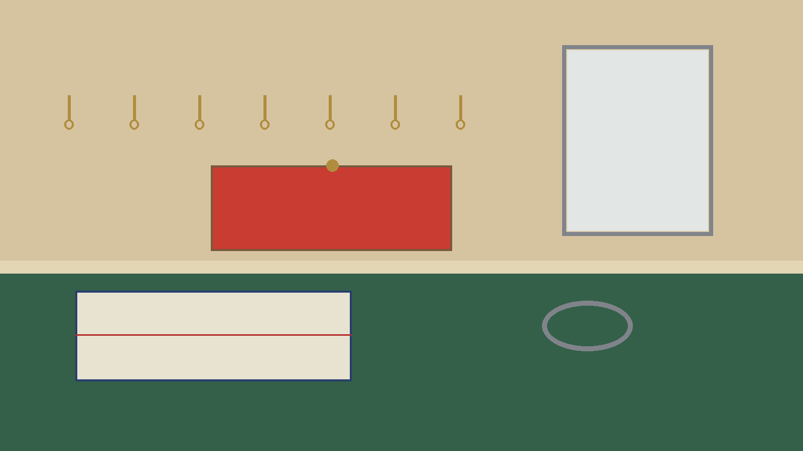
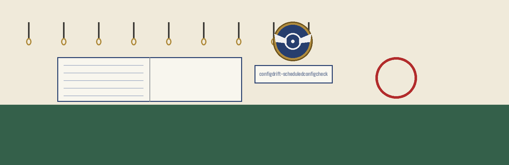

# configdrift-ScheduledConfigCheck

Theme: Telegraph Boy's Bicycle Insignia. Display face: BigShouldersInline. Text face: Barlow.

# configdrift-ScheduledConfigCheck
A simple scheduler that periodically runs a user-defined command (e.g., a configuration extraction script) and compares the output to a baseline. Alerts if differences are found. Uses `schedule` and `subprocess`. - Focused on Detects and reports deviations from baseline configurations across systems or applications. Compares current configurations to a known-good state, highlighting changes that could introduce security vulnerabilities or compliance issues. Supports multiple configuration formats (e.g., YAML, JSON) and remote configuration retrieval.

> **FIRST RUN WAITS** The first run waits one full interval before the first check.

## Install
`git clone https://github.com/ShadowStrikeHQ/configdrift-scheduledconfigcheck`

> **THE FETCHED BASELINE IS TRUSTED** A fetched baseline is trusted as the known good baseline.

## Usage
`./configdrift-scheduledconfigcheck [params]`

> **NO EXIT CODE FOR DRIFT** Drift carries no exit code, because the check returns nothing.

## Parameters
- `-h`: Show help message and exit
- `--interval`: No description provided
- `--output`: Path to output differences to file.
- `--format`: No description provided
- `--remote`: Treat the baseline as a URL to fetch the baseline configuration from.
- `--allow-http`: Allow fetching a remote baseline over plain http. Without this flag a remote baseline URL must use https.

A remote baseline is fetched with a 10 second timeout and is trusted as the known good baseline: whatever the URL returns is treated as the correct configuration to compare against, so use a source you trust. Remote baselines must use https unless `--allow-http` is passed for a plain http URL.

## License
Copyright (c) ShadowStrikeHQ

## Themed notes from the code

- A scheduler runs one named command again and again.
- Each run reads the command output as a configuration.
- Each run loads the baseline again. No caching.
- Each run compares the two with DeepDiff. Order ignored.
- Drift found means one warning line, then the differences.
- An output file is written only if --output was given.
- No drift means one plain line: No drift found, in the words of the log line No configuration drift detected.
- A failed comparison is an error. It is not a clean result.
- Working line: python3 main.py COMMAND BASELINE, followed by the options.
- COMMAND is required. BASELINE is required.
- The parameter -h shows help and then exits.
- COMMAND is the command to execute, run through bash.
- BASELINE is a baseline file in YAML or JSON.
- The parameter --interval gives seconds between runs, with a default of 60 and a minimum of 10.
- The parameter --output gives a path for the differences file, written as JSON text.
- The parameter --format takes yaml or json. Left out means autodetect.
- An ambiguous extension defaults to YAML.
- The flag --remote means the baseline is a URL, fetched each run.
- The remote fetch timeout is 10 seconds.
- The flag --allow-http allows plain http. Without it, https is required.
- A fetched baseline is trusted as correct.
- The README prints no description for --interval, and no description for --format. Both descriptions exist in the parser.
- The first run is not immediate. It waits one full interval.
- The scheduler is polled once a second.
- An interval below 10 seconds exits 1 at startup.
- Drift carries no exit code. The check returns nothing and the scheduler ignores results.
- The repository carries an MIT License file. The README licence section gives a copyright line only, in a wrong organisation name.

## Buttons and headings in this theme

- Button: RUN THE ROUND NOW
- Button: WRITE THE DIFFERENCES
- Button: FETCH THE BASELINE
- Heading: THE TIMED ROUND
- Heading: TAKING THE JOB ON
- Heading: CONTROLS IN A ROW
- Heading: WHEN THE ROUND FAILS
